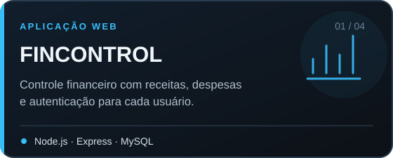
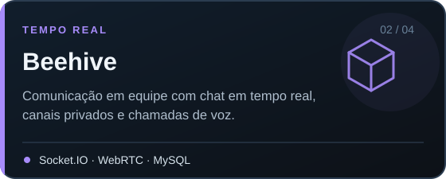
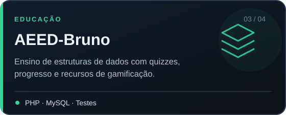
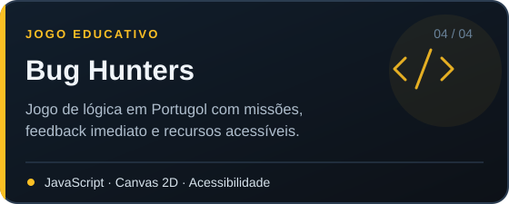

  

  <a href="#projetos-em-destaque">Projetos</a> ·
  <a href="#atividade-no-github">Atividade</a> ·
  <a href="#contato">Contato</a>

## Sobre mim

Sou técnico em Análise e Desenvolvimento de Sistemas e curso AMS na área. Desenvolvo aplicações web com foco em back-end, autenticação, bancos de dados e comunicação em tempo real. Gosto de transformar ideias em projetos funcionais, com código organizado e interfaces fáceis de usar.

## Projetos em destaque

<table>
  <tr>
    <td width="50%" valign="top">
      
    </td>
    <td width="50%" valign="top">
      
    </td>
  </tr>
  <tr>
    <td width="50%" valign="top">
      
    </td>
    <td width="50%" valign="top">
      
    </td>
  </tr>
</table>

## Atividade no GitHub

  

  
  

Dados públicos do GitHub, atualizados automaticamente por <a href="https://github.com/vn7n24fzkq/github-profile-summary-cards">GitHub Profile Summary Cards</a>.

## Contato

  
  

